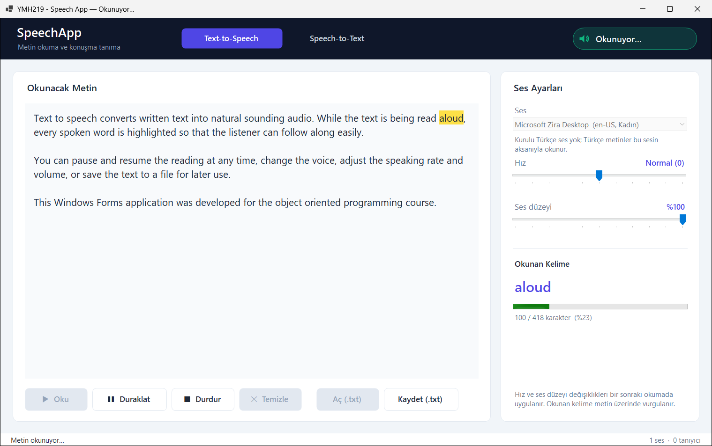
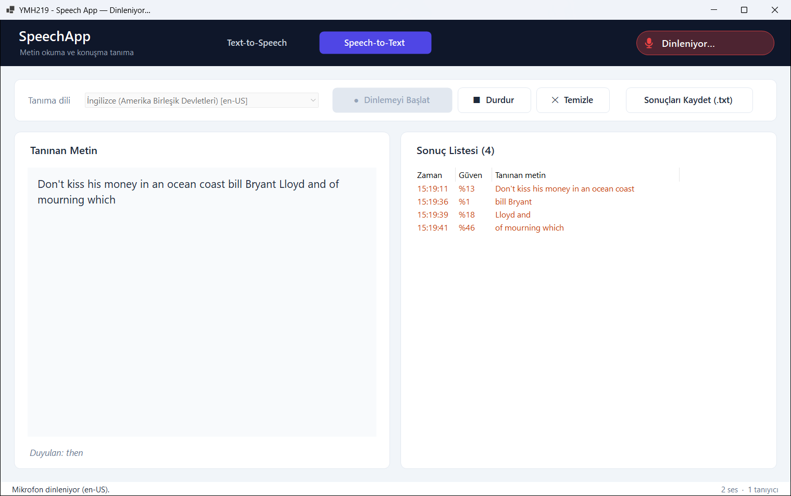

# YMH219 - Speech App (Speech-to-Text ve Text-to-Speech)

Ses ile metin arasında iki yönlü dönüşüm yapan bir Windows Forms uygulaması. **Text-to-Speech** bölümünde yazılan metin sesli okunur ve okunan kelime metin üzerinde anlık olarak vurgulanır; Türkçe ses (Microsoft Tolga) varsayılan olarak kullanılır. **Speech-to-Text** bölümünde mikrofondan alınan konuşma metne dönüştürülür; her sonuç zaman damgası ve güven skoruyla listelenir.

Bu proje, YMH 219 Nesne Tabanlı Programlama dersi ek uygulama ödevlerinin **6. ödevidir**.

## Kullanılan Teknolojiler

| Teknoloji | Açıklama |
|---|---|
| C# | Programlama dili |
| .NET 8 (`net8.0-windows10.0.19041.0`) | Hedef çatı (Windows 10 2004 ve üzeri) |
| Windows Forms | Masaüstü arayüzü |
| [`System.Speech`](https://www.nuget.org/packages/System.Speech) 8.0.0 (NuGet) | `SpeechSynthesizer` ile SAPI sesleriyle okuma, `SpeechRecognitionEngine` ile konuşma tanıma |
| `Windows.Media.SpeechSynthesis` + `MediaPlayer` (Windows SDK) | Windows OneCore sesleriyle (ör. Türkçe *Microsoft Tolga*) okuma ve kelime sınırı bilgisi |
| GDI+ (`System.Drawing`) | Yuvarlak butonlar, kartlar ve durum göstergesi simgelerinin çizimi |
| Visual Studio 2022 / 2026 | Geliştirme ortamı |

## Kurulum ve Çalıştırma

### Gereksinimler
- Windows 10 (2004+) / Windows 11
- [.NET 8 SDK](https://dotnet.microsoft.com/download/dotnet/8.0) veya daha yeni bir SDK
- Visual Studio 2022 (17.8+) veya Visual Studio 2026, **.NET masaüstü geliştirme** iş yüküyle
- Hoparlör/kulaklık (TTS) ve mikrofon (STT)

> Proje `RollForward=Major` ayarına sahiptir. Bilgisayarda .NET 8 çalışma zamanı yoksa daha yeni bir .NET masaüstü çalışma zamanında (ör. .NET 10) da çalışır. NuGet paketleri ilk derlemede otomatik indirilir.

### Visual Studio ile
1. Depoyu klonlayın:
   ```bash
   git clone https://github.com/bakibasbay/YMH219-SpeechApp.git
   ```
2. `YMH219-SpeechApp.sln` dosyasını Visual Studio ile açın.
3. **Derle > Çözümü Derle** (`Ctrl+Shift+B`), ardından **F5** ile çalıştırın.

### Komut satırı ile
```bash
cd YMH219-SpeechApp
dotnet run --project YMH219-SpeechApp
```

### Konuşma tanıma için Windows ayarları
Windows'un yerleşik tanıyıcısı **Türkçeyi desteklemez**. Speech-to-Text için İngilizce (ABD) konuşma paketi kurulu olmalıdır:

1. **Ayarlar > Saat ve dil > Dil ve bölge** bölümünde *İngilizce (Amerika Birleşik Devletleri)* dilini ekleyin.
2. Dilin yanındaki **… > Dil seçenekleri > Konuşma tanıma** paketini indirin. Bu paket, `System.Speech`'in kullandığı *Microsoft Speech Recognizer 8.0 (English - US)* tanıyıcısını kurar.
3. **Ayarlar > Gizlilik ve güvenlik > Mikrofon** bölümünde *Mikrofon erişimi* ve *Masaüstü uygulamalarının mikrofonunuza erişmesine izin verin* seçeneklerinin açık olduğundan emin olun.
4. Uygulamayı yeniden başlatın; dil, **Tanıma dili** listesinde görünür.

## Kullanım

### Text-to-Speech
1. **Text-to-Speech** sekmesinde metni yazın veya **Aç (.txt)** ile bir dosyadan yükleyin.
2. Sağ panelden sesi seçin. Liste her sesin altyapısını gösterir (`· SAPI` / `· Windows`); kurulu bir Türkçe ses varsa varsayılan olarak o seçilir.
3. **Hız** ve **Ses düzeyi** kaydırıcılarını ayarlayın.
4. **▶ Oku** ile okumayı başlatın. Okunan kelime sarı zeminle vurgulanır, sağda kelime ve ilerleme yüzdesi görünür.
5. **❚❚ Duraklat / ▶ Devam Et**, **■ Durdur** ve **✕ Temizle** ile okumayı yönetin; **Kaydet (.txt)** ile metni kaydedin.

### Speech-to-Text
1. **Speech-to-Text** sekmesinde **Tanıma dili** listesinden dili seçin (yalnızca kurulu tanıyıcılar listelenir).
2. **● Dinlemeyi Başlat** ile konuşmaya başlayın. Konuşurken ara sonuç "Duyulan: …" satırında görünür.
3. Kesinleşen her ifade **Tanınan Metin** alanına eklenir ve **Sonuç Listesi**'nde `Zaman – Güven – Metin` olarak listelenir. Güveni %50'nin altındaki sonuçlar turuncu gösterilir.
4. **■ Durdur** ile dinlemeyi bitirin, **Sonuçları Kaydet (.txt)** ile listeyi kaydedin, **✕ Temizle** ile sıfırlayın.

## Özellikler

- **Text-to-Speech:** oku, duraklat / devam et, durdur, temizle
- **İki ses altyapısı:** SAPI masaüstü sesleri (`System.Speech`) ve Windows OneCore sesleri (`Windows.Media.SpeechSynthesis`); seçilen sese göre ilgili motor otomatik kullanılır, varsayılan ses Türkçedir
- **Hız** (-10…+10) ve **ses düzeyi** (%0…%100) ayarı
- **Okunan kelimenin vurgulanması** iki altyapıda da: SAPI'de `SpeakProgress` olayı, Windows'ta ses akışındaki kelime sınırı izi (`SpeechCue`) kullanılır; ilerleme çubuğu ve yüzde bilgisi gösterilir
- Metni **.txt olarak açma / kaydetme** (UTF-8; eski Türkçe ANSI/Windows-1254 dosyalar da doğru okunur)
- **Speech-to-Text:** dinlemeyi başlat / durdur, temizle; tanınan metnin metin alanına eklenmesi ve ara sonuçların canlı gösterimi
- Sonuçların **zaman damgası ve güven skoruyla** `ListView`'da listelenmesi ve `.txt` olarak kaydedilmesi
- Kurulu tanıyıcılara göre **dil seçimi**
- **Belirgin durum göstergesi:** *Hazır* (gri), *Okunuyor…* (yeşil, hoparlör simgesi), *Duraklatıldı* (turuncu), *Dinleniyor…* (kırmızı, **yanıp sönen mikrofon simgesi**). Simgeler GDI+ ile kodla çizilir; durum pencere başlığında da gösterilir.
- Okuma ve dinleme aynı anda yapılmaz (hoparlör sesinin mikrofona karışmaması için); butonlar duruma göre aktif/pasif olur
- **Hata yönetimi:** mikrofon yok, mikrofon izni kapalı (dinleme öncesinde Windows gizlilik ayarı kontrol edilir), tanıyıcı/dil kurulu değil, ses aygıtı/sentez hatası, dosya hataları (izin, kilitli dosya, 2 MB sınırı) anlaşılır `MessageBox` ile bildirilir; beklenmeyen hatalar genel yakalayıcıyla gösterilir, uygulama kapanmaz
- Servisler `IDisposable`'dır; pencere kapanırken okuma durdurulur, mikrofon ve ses kaynakları serbest bırakılır

## Proje Yapısı ve Sınıf Tasarımı

```
YMH219-SpeechApp/
├── YMH219-SpeechApp.sln
├── README.md
├── screenshots/
└── YMH219-SpeechApp/
    ├── Program.cs                     # Giriş noktası, genel hata yakalama
    ├── MainForm.cs                    # Arayüz olayları ve durum yönetimi
    ├── MainForm.Designer.cs           # Kontrollerin yerleşimi
    ├── Models/
    │   ├── RecognitionResultEntry.cs  # Tanıma sonucu: metin, zaman, güven
    │   ├── VoiceOption.cs             # Ses listesi öğesi (ses + altyapı)
    │   ├── SpeechEngineKind.cs        # Sapi / Windows
    │   ├── LanguageOption.cs          # Dil listesi öğesi
    │   └── AppStatus.cs               # Hazır / Okunuyor / Duraklatıldı / Dinleniyor
    ├── Services/
    │   ├── TextToSpeechService.cs     # Okuma servisi: sese göre motor seçimi, olaylar
    │   ├── ISpeechEngine.cs           # Okuma motorları için ortak arayüz
    │   ├── SapiSpeechEngine.cs        # System.Speech (SAPI) motoru
    │   ├── WindowsSpeechEngine.cs     # Windows.Media.SpeechSynthesis + MediaPlayer motoru
    │   ├── SpeechToTextService.cs     # SpeechRecognitionEngine ile mikrofon tanıma
    │   ├── FileService.cs             # .txt kaydet / aç
    │   ├── ServiceException.cs        # Kullanıcıya gösterilecek hata
    │   └── WordProgressEventArgs.cs   # Okunan kelime bilgisi
    ├── Controls/
    │   ├── ModernButton.cs            # Yuvarlak köşeli buton
    │   ├── CardPanel.cs               # Kart görünümlü panel
    │   └── StatusIndicator.cs         # Renkli durum göstergesi
    └── UI/
        └── Theme.cs                   # Renkler ve çizim yardımcıları
```

| Sınıf | Sorumluluk |
|---|---|
| `TextToSpeechService` | Seçilen sesin altyapısına göre etkin motoru (`ISpeechEngine`) belirler; `SpeakAsync`, `Pause`, `Resume`, `Stop`, `Rate`, `Volume`, `SelectVoice` sağlar ve `WordProgress`, `StateChanged`, `SpeakFinished` olaylarını yalnızca etkin motordan aktarır. `IDisposable`. |
| `ISpeechEngine` | SAPI ve Windows okuma motorlarının ortak sözleşmesi (çok biçimlilik). |
| `SapiSpeechEngine` | `System.Speech.Synthesis.SpeechSynthesizer` ile okuma; kelime konumu `SpeakProgress` olayından gelir. |
| `WindowsSpeechEngine` | Metni `SynthesizeTextToStreamAsync` ile ses akışına çevirir, `MediaPlayer` ile çalar; kelime konumu akıştaki `SpeechWord` izinin `SpeechCue` öğelerinden okunur. |
| `SpeechToTextService` | `SpeechRecognitionEngine` + `DictationGrammar` ile mikrofondan sürekli tanıma; `Start`, `Stop` ve `Recognized`, `Hypothesized`, `ListeningChanged`, `ErrorOccurred` olayları. Dinleme öncesi mikrofon iznini kontrol eder. `IDisposable`. |
| `RecognitionResultEntry` | Değiştirilemez sonuç nesnesi (`Text`, `Timestamp`, `Confidence`); `ToString()` kayıt biçimini üretir. |
| `FileService` | Metin ve sonuç dosyalarını okur/yazar; G/Ç hatalarını `ServiceException`'a çevirir. |
| `ServiceException` | Başlık + açıklama taşıyan, doğrudan `MessageBox`'ta gösterilebilen hata. |
| `MainForm` | Yalnızca arayüz: kullanıcı etkileşimini alır, servisleri çağırır, olaylara göre ekranı günceller. |

## Ekran Görüntüleri

### Text-to-Speech: Türkçe ses (Microsoft Tolga) ile okuma, kelime vurgusu ve "Okunuyor…" göstergesi


### Speech-to-Text: gerçek konuşmadan tanınan sonuçlar, zaman damgası ve güven skoru, "Dinleniyor…" göstergesi


## Bilinen Sınırlamalar / Geliştirme Notları

- **Türkçe konuşma tanıma yoktur.** Windows'un yerleşik tanıyıcıları Türkçe dikteyi desteklemez; uygulama İngilizce (ABD) tanıyıcıyla kullanılır.
- **Tanıma doğruluğu düşüktür.** Kullanılan *Microsoft Speech Recognizer 8.0* eski bir masaüstü dikte motorudur, ana dili İngilizce olan konuşmacılar için eğitilmiştir ve Windows 11 24H2 ile ses eğitimi aracı kaldırıldığı için kullanıcıya uyarlanamaz. Gerçek konuşmayla yapılan testte (dizüstü dahili mikrofonu, Türkçe aksanlı İngilizce) sonuçlar listeye zaman ve güvenle düştü, ancak ifadelerin çoğu yanlış tanındı ve güven skorları %0–53 arasında kaldı. Bu sınır uygulamanın değil motorun sınırıdır; ekran görüntüsündeki sonuçlar da bu testten gelir.
- **Windows.Media.SpeechRecognition denendi ve çıkarıldı.** Modern Windows dikte API'si de denendi: motor sesi aldı ve konuşmayı algıladı (`SpeechDetected`), ancak çevrimiçi konuşma tanıma ve mikrofon izinleri açık olmasına rağmen üç gerçek konuşma denemesinde hiç ara sonuç ya da sonuç üretmedi. Masaüstü uygulamalarında bu API'nin pencere odağı kaybolunca sessizce devre dışı kaldığı da bildirilmektedir. Çalıştığı doğrulanamadığı için tanıma yalnızca `System.Speech` ile yapılır.
- **Türkçe ses yalnızca Windows altyapısında vardır.** *Microsoft Tolga (tr-TR)* bir OneCore sesidir ve `System.Speech` tarafından görülmez; bu yüzden ikinci TTS motoru (`Windows.Media.SpeechSynthesis`) eklendi ve hedef çatı `net8.0-windows10.0.19041.0` olarak seçildi.
- Hız değişikliği bir sonraki **Oku** işleminde uygulanır: SAPI kuyruğa alınmış metnin hızını okuma sırasında değiştirmez (okurken hız +10 yapıldığında okuma hızı değişmedi, yeni okumada yaklaşık 3 katına çıktı); Windows altyapısında ise hız metin sese dönüştürülürken uygulanır.
- Okuma sırasında kelime vurgusunun kaymaması için metin alanı salt okunur yapılır.
- Mikrofon izni dinleme öncesinde Windows gizlilik ayarından okunur; izin kapalıyken `System.Speech` hata vermeden başlayıp sonradan kesildiği için bu kontrol eklenmiştir.
- Açılabilecek metin dosyası 2 MB ile sınırlıdır; kayıtlar UTF-8 (BOM'lu) olarak yazılır.
- Olası geliştirmeler: Vosk gibi çevrimdışı bir kütüphane ile Türkçe ve daha doğru konuşma tanıma, harici/kulaklık mikrofonu seçimi.

## Öğrenci

**Muhammed Baki Başbay** – 250541016

YMH 219 Nesne Tabanlı Programlama – Ek Uygulama Ödevleri
